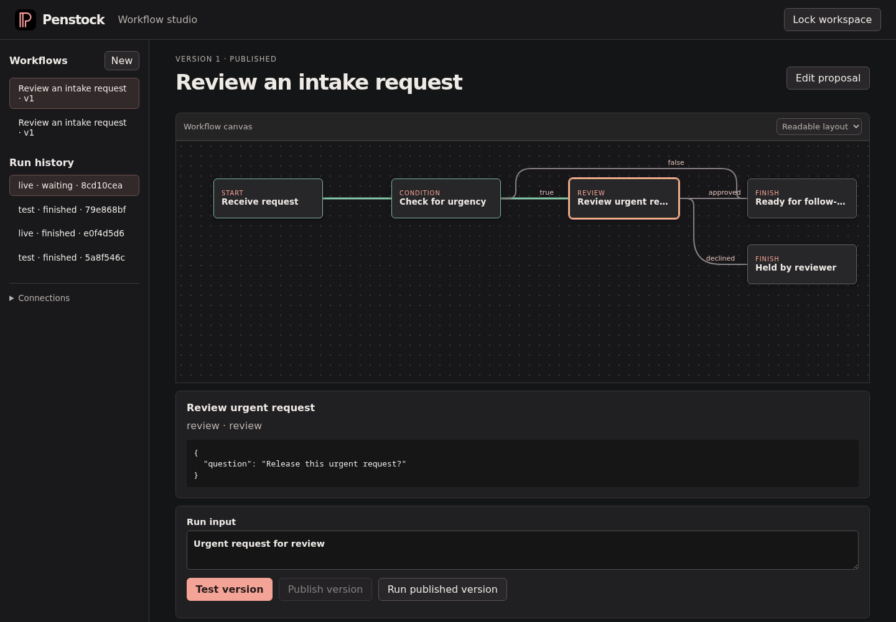

# Penstock

**Work in progress · Source-available for noncommercial use**

Created by Miguel Rodriguez. You can self-host, modify and share Penstock for noncommercial use with attribution. Contact Miguel before using this edition commercially. [License](LICENSE) · [Commercial licensing inquiries](https://github.com/MRodriguez2010/Penstock-Community/issues/new?title=Commercial+licensing+inquiry)

Penstock turns a description of a job into a workflow you can inspect before you run it. Choose your model, review the proposed graph, and follow the input and output of each step. A person can approve a branch or inspect exactly what a service will receive. The studio and run history live on your infrastructure.



## Try a workflow in five minutes

Use Python 3.11 or newer for the offline starter, project tables, reviews and fixed-interval schedules. Calendar schedules also use Node.js and an IANA time zone database. For all blocks, install Node.js 22 or newer and run `npm ci --ignore-scripts` in the checkout, or use the container below. On systems without an IANA database, run `python -m pip install tzdata`. On Windows, use `py -3` in place of `python3`.

```sh
git clone https://github.com/MRodriguez2010/Penstock-Community.git
cd Penstock-Community
python3 penstock.py init
python3 penstock.py key
python3 penstock.py serve
```

Open [the local studio](http://127.0.0.1:8765). Paste the owner key from the terminal. The starter workflow runs entirely offline.

1. Open **Review an intake request**. The canvas shows where ordinary requests finish and where urgent ones need a decision.
2. Leave the sample input in place and select **Test version**. Select a block to inspect its configuration. Approve the urgent request and open its receipt.
3. Select **Publish version**, then **Run published version**. Try an input without the word `urgent` to follow the other branch. Previous runs remain attached to the version that produced them.

## Bring your models, skills, and services

`init` creates `.workspace/connections.toml`, a sample Markdown skill, and a random owner key. You can configure several model profiles at once. Each profile names a protocol, the full request URL, and the model ID that your endpoint actually serves.

```toml
[providers.local]
protocol = "ollama"
url = "http://127.0.0.1:11434/api/chat"
model = "your-installed-model"

[providers.hosted]
protocol = "chat-completions"
url = "https://models.example.org/v1/chat/completions"
model = "your-provider-model-id"
key_env = "MODEL_API_KEY"

[services.inbox]
url = "https://service.example.org/reviewed-input"
key_env = "INBOX_TOKEN"

[skills]
summarize = "skills/summarize.md"
```

Replace the example URLs and model IDs. Export any named environment variables in the process running Penstock. Restart the server after changing configuration. `python3 penstock.py check` validates configuration and lists the registered names without contacting endpoints. Install or start the model server separately. The protocol adapters support [Ollama chat](https://docs.ollama.com/api/chat), [Chat Completions](https://developers.openai.com/api/reference/resources/chat), and [Anthropic Messages](https://platform.claude.com/docs/en/api/messages/create). [Configuration template](examples/connections.toml)

Choose **New**, select the drafting model, and describe the job. For example, with the profiles above, ask *“Use local to summarize this request with the summarize skill. Have me review it. Send approved summaries to inbox and finish declined requests without delivery.”* Inspect the proposal, save the draft, then test it. A workflow can use a different model at each Agent step.

Skills are UTF-8 Markdown files under your workspace. An Agent includes the selected skill in its instructions. Services accept an HTTP POST with `{"input": ...}` and return JSON or an empty body. The workflow can select only services you registered. At each delivery the studio displays the payload and asks for approval. You can also register JSON HTTP endpoints, RSS feeds, MCP servers and A2A agents. Each workflow can use the services you install. Test mode previews delivery locally. **Model calls in a test use the configured endpoint and can incur charges.**

## Run with containers

```sh
docker compose up -d --build
docker compose exec penstock python penstock.py key
```

Open the same local studio. Compose binds to loopback and persists the workspace in a named volume. To configure it, copy the template out, edit it, copy it back, and restart. Copy custom skills in the same way. Keep edited files readable by container user 65532.

```sh
docker compose cp penstock:/workspace/connections.toml ./connections.local.toml
# Edit connections.local.toml, then install it:
docker compose exec -T penstock sh -c 'cat > /workspace/connections.toml' < ./connections.local.toml
docker compose restart penstock
```

The endpoint must be reachable from inside the container. A model server in the same Compose network can use its service name. Docker Desktop provides `host.docker.internal` for services on the host. On Linux, configure the network and listening address to suit the deployment, or use the Python install beside a loopback-only model. Add any custom credential variable names to the Compose service environment, then recreate the container. To use a different published port, set `PENSTOCK_PORT`.

## What this edition runs today

| Capability | Behavior |
| --- | --- |
| Workflow proposals | A configured local or hosted model proposes a bounded graph. You can also edit the JSON proposal or use the offline starter. |
| Visual orchestration | Inspect the graph, change its layout, follow branches, fan out to several steps, and join selected branches. The run cursor executes branches in deterministic order. |
| Model steps | Select a provider and optional instruction skill per step. An optional response schema validates typed model outputs. |
| Review and delivery | Human reviews route approved and declined work. Each service call has its own payload review. |
| Versioned governance | Save an immutable version, test it, and explicitly publish it. Changing a selected endpoint, model or skill requires saving and testing a new version. |
| Receipts and recovery | Each run records its version, decision, outputs, and selected model. A pending decision survives a restart. Interrupted operations are recorded and require an explicit new run. |
| Project data | Create typed tables, edit rows, import or export CSV, save project files and keep versioned knowledge documents. Test runs use a disposable project database. |
| Schedules and events | Pin each trigger to a published version. Use intervals, calendar schedules, authenticated webhooks, table changes, project changes or polling for new feed and service items. |
| Workflow blocks | Use named variables, checks, waits, input forms, model routing, sandboxed JavaScript, project memory, child workflows and bounded loop or parallel bodies. |

**Try a project table.** Open **Tables and schedules**, choose **Create or import a table**, enter a table name and column names, then add a row. For a scheduled run, publish a tested workflow first. Select it in the same panel, preview the next occurrences and enable the trigger. Open a delivery to inspect its receipt. [Tables, schedules and block reference](docs/project-workflows.md)

This release targets a single trusted workspace owner. Setup uses a local configuration file. Graph editing currently uses proposals and JSON, with the canvas for inspection. Multi-user permissions, desktop control, and provider-specific native tools remain work in progress. [Workflow format and operational guide](GUIDE.md)

## Contributing

Run `python3 -m unittest discover -s tests -v`. With Node.js 22 or newer, run `node --test tests/*.mjs` for the canvas tests. CI also installs the Compose version and drives the studio through a browser. Open a pull request with the intended behavior and the check you used. Portability fixes and support for additional providers are welcome. [Contribution terms](CONTRIBUTING.md)

## License

The Penstock Community Noncommercial License covers current first-party releases. It requires attribution to Miguel Rodriguez. Business operations, paid client work and commercial hosting require a separate written license from Miguel. You can open a licensing inquiry with just a request to get in touch. Keep confidential business details out of the public issue. [Full terms](LICENSE)

The earlier snapshot at commit `3dffaf6` was published under MIT. Its MIT grant continues to apply to that material. Third-party components retain their own licenses. [Earlier snapshot and license](https://github.com/MRodriguez2010/Penstock-Community/blob/3dffaf6aebd4ce7cd431c9315f4b3919edf56271/LICENSE)
